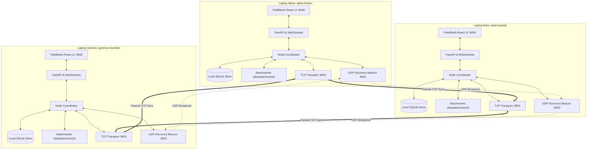

# RescueNet: Network Architecture Specification

## 1. Decentralized Peer-to-Peer Topology

RescueNet operates as an **autonomous, leaderless, offline peer-to-peer mesh network**. There is no central server, master database, or cloud coordination service.

Every participating device (laptop or tablet) is an independent, equal peer hosting a full local stack:
- Local SQLite Append-Only Event Store
- Deterministic State Projector Reducer
- Cryptographic Keyring & Zero-Trust Manifest
- TCP Stream Framed Transport
- UDP Broadcast Peer Discovery Beacon
- Autonomous Anti-Entropy Gossip Synchronization Engine
- Embedded FastAPI Application & WebSocket Streamer



---

## 2. Protocol Layering

| Layer | Component | Implementation | Function |
| :--- | :--- | :--- | :--- |
| **Presentation** | FieldMesh Web UI | React + Vite + Three.js | Real-time tactical 2D map, 3D terrain, incident board, triage cards, chat |
| **Interface** | REST & WebSockets | FastAPI + Uvicorn | Client endpoints (`/api/node/...`), real-time live push (`/ws`) |
| **Domain State** | State Projector | `storage/projector.py` | Pure functional reducer folding append-only events into domain state |
| **Persistence** | SQLite Store & Attachments | `storage/sqlite_store.py` & `attachments.py` | Local database (`data/<id>.db`) and SHA-256 content-addressable file store |
| **Security** | Zero-Trust Crypto | `crypto/keyring.py` & `ciphers.py` | Ed25519 signing/verification, AES-256-GCM Mesh PSK field encryption |
| **Synchronization** | Anti-Entropy Gossip | `sync/node.py` & `gossip.py` | Version vectors, gap detection, zlib compression, immediate wakeup push |
| **Transport** | TCP Stream Framing | `transport/tcp.py` | 4-byte big-endian length prefix framing over direct IP sockets |
| **Discovery** | UDP Beacon & Fallback | `transport/discovery.py` & `peer_ips.txt` | Subnet broadcast on port `8002` + manual configuration fallback |

---

## 3. Wire Protocols & Framing

### TCP Framing Specification (Port 8001)
TCP is a streaming byte protocol without built-in message boundaries. RescueNet enforces explicit stream framing using a **4-byte unsigned big-endian length header**:

```
+-----------------------------------+---------------------------------------+
|  4 Bytes: Message Length (N)      |  N Bytes: Canonical JSON Payload      |
|  struct.pack("!I", length)        |  UTF-8 encoded TransportMessage       |
+-----------------------------------+---------------------------------------+
```

Incoming frames exceeding `10 MB` are rejected immediately to protect against memory exhaustion attacks.

### Anti-Entropy Handshake Protocol Flow
When Node A synchronizes with Node B:

1. **`SYNC_REQUEST` (A -> B):**
   - Transmits Node A's Version Vector $V_A = \{ \text{node\_id}: \text{counter} \}$ and detected sequence gaps.
2. **`SYNC_RESPONSE` (B -> A):**
   - Node B computes $V_B$ and determines which events Node A is missing ($E_{B \setminus A}$).
   - Compresses $E_{B \setminus A}$ using zlib and sends back with $V_B$ and gaps.
   - Node A verifies Ed25519 signatures and ingests missing events into local SQLite.
3. **`SYNC_DELTA` (A -> B):**
   - Node A computes what events Node B is missing ($E_{A \setminus B}$) and transmits compressed delta to B.
4. **`SYNC_ACK` (B -> A):**
   - Node B ingests validated events and returns count of newly accepted events.

At the conclusion of the handshake, both nodes hold the exact mathematical union of histories:
$$\mathcal{E}_{\text{new}} = \mathcal{E}_A \cup \mathcal{E}_B$$

---

## 4. Zero-Trust Security & Cryptographic Invariants

1. **Private Key Isolation:** Each physical laptop holds **only its own** private Ed25519 signing key (`security/<node_id>/identity.key.enc`). The private key is decrypted into memory at startup using the node passphrase.
2. **Peer Manifest Authentication:** Each laptop maintains `trusted_peers.json` listing the approved public keys of legitimate mesh members.
3. **Fail-Closed Verification:** Incoming events are dropped before reaching SQLite if:
   - Node ID is unknown or not in `trusted_peers.json`.
   - Node has been revoked via `REVOKE_NODE` action.
   - Digital signature is missing or fails Ed25519 verification.
4. **Mesh Field Encryption (AES-256-GCM):**
   - Sensitive personal victim information (medical history, contact info, notes) is encrypted at rest using the shared 256-bit Mesh Pre-Shared Key (PSK).
   - Plaintext never touches disk or unauthenticated wire buffers.

---

## 5. Offline Data Categories

| Entity Type | Entity ID Format | Key Operations | Domain Role |
| :--- | :--- | :--- | :--- |
| **`incident`** | `inc-<timestamp/uuid>` | `CREATE`, `ASSIGN_TEAM`, `CLOSE_INCIDENT` | Disaster incidents, breach points, structural fires |
| **`victim`** | `vic-<timestamp/uuid>` | `CREATE`, `UPDATE_TRIAGE` | Casualty status, triage tag (RED/YELLOW/GREEN/BLACK) |
| **`rescuer`** | `res-<id>` | `CREATE`, `ASSIGN_MISSION`, `UPDATE` | First responder squads, callsigns, deployment status |
| **`supply`** | `sup-<id>` | `INIT_ESCROW`, `CONSUME_QUOTA`, `TRANSFER_QUOTA` | Relief resources (plasma, water, blankets, generators) |
| **`need`** | `need-<id>` | `CREATE`, `RESOLVE` | Urgent supply and medical requirements from field bases |
| **`alert`** | `alt-<id>` | `CREATE`, `ACKNOWLEDGE`, `RESOLVE` | High-priority emergency broadcasts (landslides, tsunamis) |
| **`chat`** | `msg-<id>` | `CREATE` | Inter-operator situational text chat across mesh channels |
| **`attachment`** | `att-<sha256[:16]>` | `CREATE`, `TOMBSTONE` | Content-addressable situational photos, maps, diagrams |

---

## 6. Fault Tolerance & Partition Recovery

- **Partition Resistance:** If a laptop is moved out of Wi-Fi range or into a radio shadow, local operations continue uninterrupted with writes committed to local SQLite.
- **Store-and-Forward Buffering:** All mutations generate monotonically incremented events stored locally.
- **Transitive Convergence:** When disconnected nodes reconnect or relay through an intermediate node, anti-entropy delta exchanges automatically propagate all missed events.
- **Idempotent Deduping:** SHA-256 content hashes prevent duplicate records upon redundant multi-path sync.
